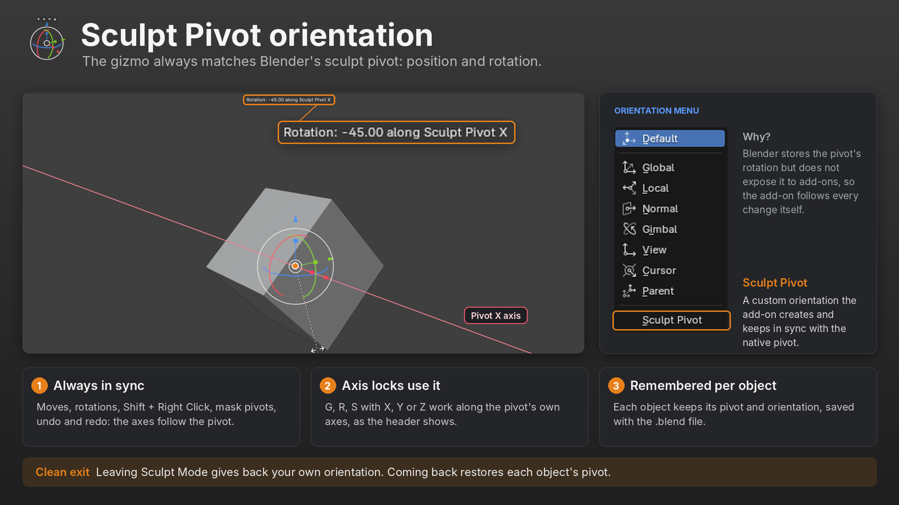
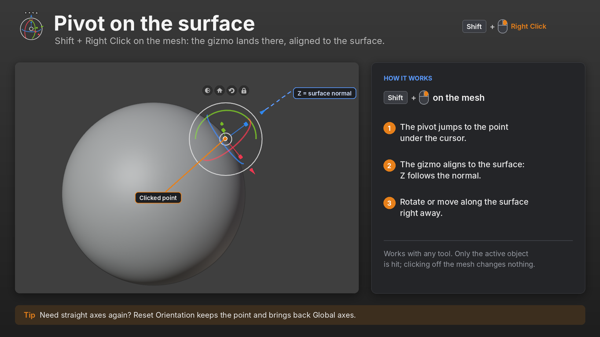
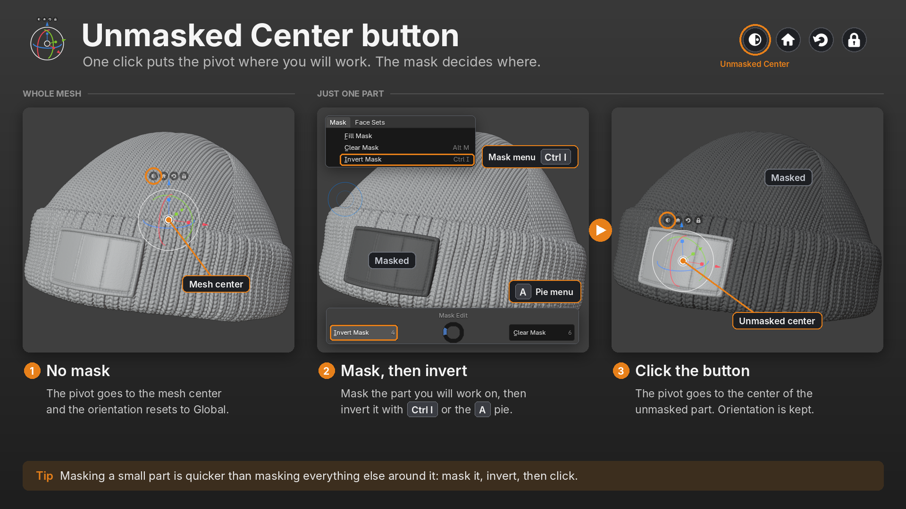
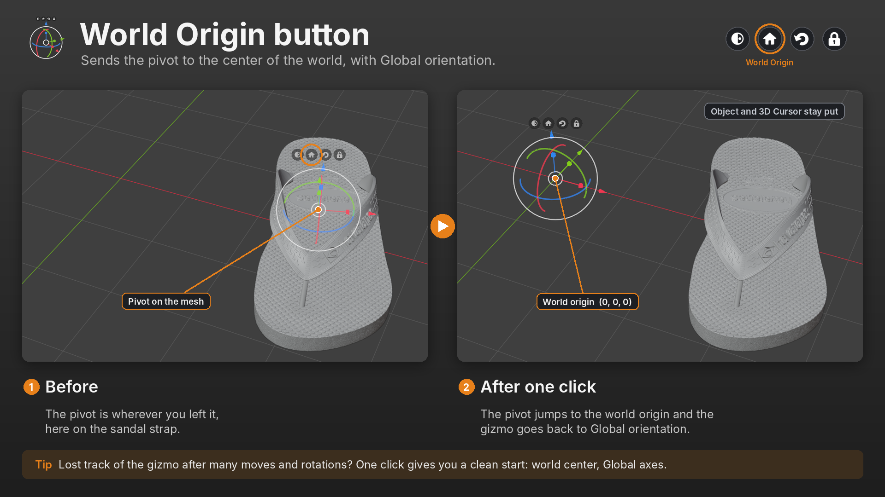
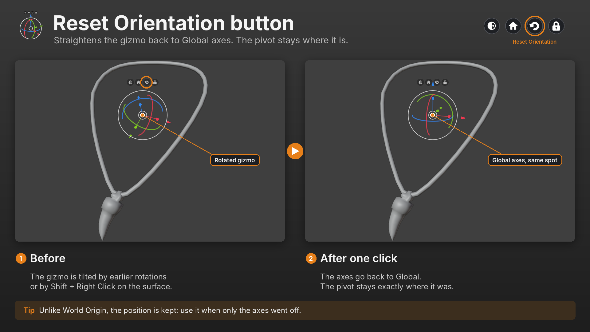
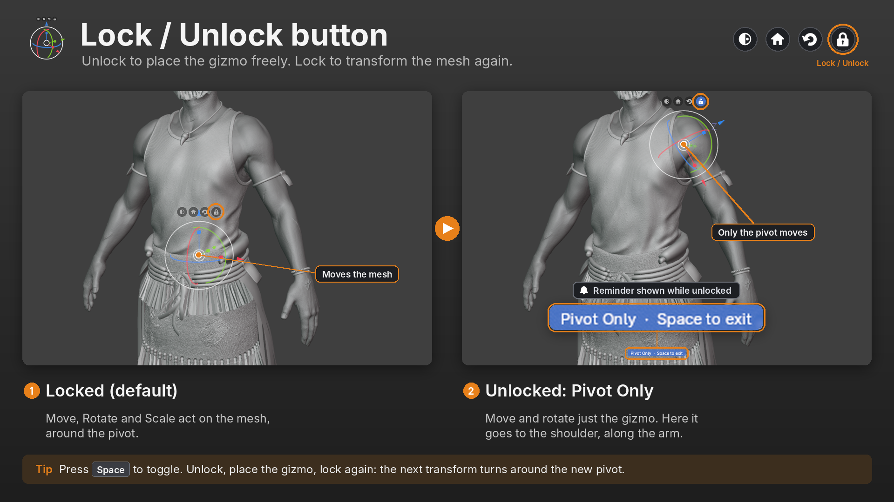
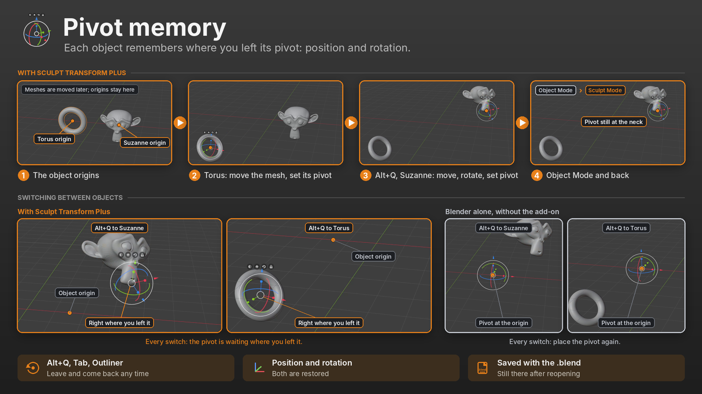

<h1 align="center">Sculpt Transform Plus</h1>

  <b>A Sculpt Mode Transform tool whose gizmo stays aligned with the sculpt pivot.</b> 
  A free add-on for Blender 5.3 and newer.

In Sculpt Mode, Blender's pivot has its own position **and rotation**: it turns with the mesh every time you rotate. The Transform gizmo, though, always follows the header's Orientation, so after the first rotation the gizmo and the pivot no longer point the same way, and there is no way to reset the pivot's rotation.

Sculpt Transform Plus keeps the gizmo glued to the sculpt pivot, in position and rotation, through every move, rotate, trackball, undo and redo. It adds a few buttons above the gizmo to place, reset and unlock the pivot, and it remembers the pivot of each object. Everything is built on Blender's own tools: the add-on never replaces how sculpting works, it only keeps the gizmo honest.

<!-- VIDEO: drag sculpt-transform-plus-demo.mp4 onto this line in the GitHub editor -->

## Features

- **Gizmo aligned with the pivot.** After any rotation, the gizmo axes are the pivot axes, so constrained moves and rotations go exactly where you expect.
- **Pivot on the surface.** `Shift` + right click places the pivot on the surface under the cursor and aligns the gizmo to the surface normal.
- **Pivot Only.** Unlock the gizmo to move and rotate only the pivot, not the mesh (Blender 5.3's *Transform Only Pivot*), then lock it again.
- **Buttons above the gizmo.** Unmasked Center, World Origin, Reset Orientation and Lock / Unlock, always one click away.
- **Pivot remembered per object.** Each object keeps its pivot where you left it, saved in the .blend file. The first time, the pivot starts at the mesh center instead of the object origin.
- **Keyboard transforms.** `G`, `R` and `S` move, rotate and scale with the transform tools, with axis locks and typed values as in Object Mode.
- **Native undo.** `Ctrl Z`, `Ctrl Shift Z` and *Adjust Last Operation* keep the gizmo and the pivot together.
- **Pivot Point taken care of.** Sculpt Mode hides the *Pivot Point* menu, but the Transform tool still follows it. With *3D Cursor* or *Active Element* set in Object Mode, the gizmo would leave the sculpt pivot, so in Sculpt Mode the add-on uses *Median Point* and gives your setting back when you leave.

## A closer look

### Gizmo and pivot always together

The gizmo uses a **Sculpt Pivot** orientation that the add-on keeps in sync with Blender's pivot, so axis locks work along the pivot's own axes.

### Pivot on the surface

<!-- VIDEO: drag pivot-on-surface.mp4 onto this line in the GitHub editor -->

### Unmasked Center

### World Origin

### Reset Orientation

### Lock / Unlock

### Pivot memory

<!-- VIDEO: drag pivot-memory.mp4 onto this line in the GitHub editor -->

## Installation

**From Blender** (recommended): open *Edit › Preferences › Get Extensions*, search for **Sculpt Transform Plus** and click *Install*.

**From a file:** download `sculpt_transform_plus-0.1.0.zip` from the [Releases](https://github.com/hervert-ferreira/sculpt-transform-plus/releases) page, then in Blender use *Edit › Preferences › Get Extensions*, open the menu in the top-right corner and choose *Install from Disk*.

Requires Blender **5.3** or newer.

## How to use

1. Enter **Sculpt Mode** and pick the **Transform** tool (`Ctrl T`). Move, Rotate and Scale work too.
2. Place the pivot with `Shift` + right click on the surface, or with the buttons above the gizmo.
3. Drag the gizmo, or press `G`, `R` or `S` (add `X`, `Y` or `Z` to lock an axis, type a value, `Enter` to confirm).
4. Press `Space` to unlock the gizmo and adjust only the pivot; press `Space` again to lock it.

## Buttons

| Button | Name | What it does |
|---|---|---|
|  | **Unmasked Center** | Pivot to the center of the unmasked area. With nothing masked: the mesh center, in Global orientation. |
|  | **World Origin** | Pivot to the world origin, in Global orientation. The object origin and the 3D Cursor are not changed. |
|  | **Reset Orientation** | Pivot and gizmo back to Global orientation, keeping the pivot position. |
|  | **Unlock Gizmo** | The gizmo moves and rotates only the pivot, not the mesh. A "Pivot Only" label shows while unlocked. |
|  | **Lock Gizmo** | The gizmo moves and rotates the mesh again. |

## Shortcuts

| Shortcut | Where | Action |
|---|---|---|
| `Shift` + right click | Sculpt Mode | Pivot on the surface, gizmo aligned to the surface normal |
| `Space` | Transform, Move, Rotate, Scale tools | Lock / unlock the gizmo (Pivot Only) |
| `Ctrl T` | Sculpt Mode | Transform tool |
| `G` / `R` / `S` | Transform, Move, Rotate, Scale tools | Move / rotate / scale (`R R`: trackball) |

With any other tool, `Space` keeps your own *Spacebar Action* (Play, Tools or Search). With a brush that uses a stencil, `Shift` + right click keeps Blender's stencil control.

## Preferences

*Edit › Preferences › Add-ons › Sculpt Transform Plus*

| Option | What it does |
|---|---|
| **Pivot on First Entry** | Where the pivot starts on an object without a remembered pivot: *Mesh Center* (default) or *Object Origin* (Blender's behavior). |
| **Remember Pivot per Object** | Each object keeps its pivot (position and rotation), saved in the .blend file. On by default. |

## Known limitations

**From Blender itself**

- **Scaling along one axis follows the world axes.** When the gizmo is not in Global orientation, Blender scales Sculpt Mode along the world axes anyway. This also happens without the add-on (for example with the Cursor orientation). Uniform scale, moving and rotating work in any orientation. To scale along one axis, click **Reset Orientation** first.
- **Undoing a pivot-only change keeps the pivot.** Blender removes the step but leaves the pivot where it is; the gizmo stays on it. Use **Reset Orientation** or **World Origin** to bring it back.

**Multires and Dyntopo**

- **Python cannot read the mask on Multires and Dyntopo.** Unmasked Center still places the pivot at the center of the unmasked area, but the add-on cannot compute that position, so the buttons wait at the top of the viewport. The same happens after a Mask Expand that moves the pivot.
- **On Multires, `Shift` + right click aligns the gizmo to the base mesh normal.** The pivot lands exactly on the sculpted surface, but on strong details the gizmo tilt can differ slightly.

**Pivot tracking**

Blender does not expose the sculpt pivot to Python, so the add-on follows every operation to know where it is.

- **Changes outside the operator history** cannot be followed: scripts, other add-ons that transform the mesh, or *Set Pivot Position › Active Vertex*. If the gizmo drifts, leave and re-enter Sculpt Mode.
- **Enabling or updating the add-on during a sculpt session** syncs the gizmo again only after you leave and re-enter Sculpt Mode.

**Interface**

- **`Shift` + right click does not show the *Set Pivot Position* panel.**
- **With the Industry Compatible keymap,** `G`, `R` and `S` are not added, because `R` and `S` already have other meanings there.
- **Unmasked Center on very dense meshes** without Multires reads the whole mesh: about 0.4 s for 1.4 million vertices.

## Support

Found a bug or have an idea? Open an [issue](https://github.com/hervert-ferreira/sculpt-transform-plus/issues).

## License

Sculpt Transform Plus is free software, released under the [GNU General Public License v3.0 or later](LICENSE).
